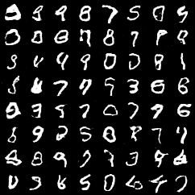

# sps-genai — Applied Generative AI

FastAPI service with four models:

- **Bigram text generation** (Module 3 class activity) — `POST /generate`
- **Word embeddings with spaCy** (Assignment 1) — `POST /embedding`
  Returns the 300-dimensional `en_core_web_lg` vector for a word.
- **CNN image classifier** (Assignment 2) — `POST /classify-image`
  Returns the most likely CIFAR-10 classes for an uploaded image.
- **GAN digit generator** (Assignment 3) — `GET /generate-digits`
  Returns a PNG grid of new handwritten digits generated from random noise.

## Run with Docker

```bash
docker build -t sps-genai .
docker run -p 8000:80 sps-genai
```

Then open http://127.0.0.1:8000/docs

## Run locally (without Docker)

```bash
uv sync
uv run fastapi dev app/main.py
```

## Example requests

```bash
# Word embedding
curl -X POST http://127.0.0.1:8000/embedding \
  -H "Content-Type: application/json" \
  -d '{"word": "apple"}'

# Text generation
curl -X POST http://127.0.0.1:8000/generate \
  -H "Content-Type: application/json" \
  -d '{"start_word": "the", "length": 10}'

# Image classification (top 3 classes)
curl -X POST "http://127.0.0.1:8000/classify-image?top_k=3" \
  -F "file=@cat.jpg;type=image/jpeg"

# Generate 16 handwritten digits (same seed = same digits); saves a PNG
curl "http://127.0.0.1:8000/generate-digits?num_images=16&seed=42" -o digits.png
```

`/embedding` returns `404` if the word is not in the model's vocabulary,
and `422` if the word is empty.

`/classify-image` accepts JPEG or PNG uploads. It returns `415` for other
file types, `400` for empty or unreadable images, and `422` if `top_k`
is outside 1–10.

`/generate-digits` returns `422` if `num_images` is outside 1–64.
Because it is a GET endpoint, it can also be opened directly in a browser,
e.g. http://127.0.0.1:8000/generate-digits?num_images=16&seed=42

## Image classifier (Assignment 2)

The CNN in `app/cnn_model.py` follows the assignment spec: 64×64×3 input,
two Conv2D (16 and 32 filters, 3×3, stride 1, padding 1) + ReLU + 2×2 max
pooling blocks, then fully connected layers of 100 and 10 units
(825,398 parameters). CIFAR-10 images (32×32) are resized to 64×64 to
match the spec input.

Trained for 10 epochs on CIFAR-10 (Adam, lr 0.001, batch size 64) with
`python -m training.train_cnn --epochs 10`, run on a Google Colab GPU.
Trained weights: `app/weights/cifar10_cnn.pt`.

```
epoch     loss  train acc  test acc
    1   1.3666      51.0%     59.5%
    2   0.9978      64.8%     65.8%
    3   0.8294      70.6%     66.2%
    4   0.7020      75.2%     67.8%
    5   0.5887      79.3%     67.9%
    6   0.4750      83.3%     67.3%
    7   0.3757      87.0%     67.0%
    8   0.2876      90.0%     67.0%
    9   0.2125      92.6%     66.0%
   10   0.1674      94.2%     65.1%
Final test accuracy: 65.07%
```

Test accuracy peaked at 67.9% after epoch 5 and then declined, while
training accuracy kept rising to 94.2%. After epoch 5 the model began
overfitting, memorizing training images rather than learning patterns that
generalize. The spec's architecture has no regularization (such as Dropout
or BatchNorm), so this is expected; stopping around epoch 5 would have given
slightly better test accuracy.

Because the model learned from small 32×32 CIFAR-10 images, predictions on
real high-resolution photos are less reliable than the test accuracy suggests.

## GAN digit generator (Assignment 3)

`GET /generate-digits` returns a PNG grid of generated handwritten digits.
Query parameters: `num_images` (1–64, default 16) and an optional `seed`
(the same seed always returns the same digits).

The GAN in `app/gan_model.py` follows the assignment spec:

- **Generator:** noise (100) → Linear to 7×7×128 → reshape →
  ConvTranspose2d 128→64 (14×14) + BatchNorm + ReLU →
  ConvTranspose2d 64→1 (28×28) + Tanh (765,761 parameters)
- **Discriminator:** image (1×28×28) → Conv2d 1→64 (14×14) + LeakyReLU(0.2) →
  Conv2d 64→128 (7×7) + BatchNorm + LeakyReLU(0.2) → Flatten → Linear → 1
  (138,817 parameters)

Trained on MNIST for 30 epochs as a standard GAN (binary cross-entropy loss,
Adam with lr 0.0002 and β1 = 0.5, batch size 128) with
`python -m training.train_gan --epochs 30`, run on a Google Colab GPU.
Only the Generator's weights are needed for the API:
`app/weights/gan_generator.pt`. Inference code is in `app/digit_generator.py`.

| Epoch | D loss | G loss | D(real) | D(fake) |
|---|---|---|---|---|
| 1 | 0.3426 | 2.5085 | 0.864 | 0.143 |
| 10 | 0.3332 | 2.8072 | 0.874 | 0.126 |
| 20 | 0.2549 | 3.3290 | 0.902 | 0.099 |
| 30 | 0.2884 | 3.6106 | 0.903 | 0.097 |

D(real) and D(fake) are the discriminator's average confidence that real and
generated images are real. The discriminator stayed ahead throughout
training: it scored real digits around 0.9 and fakes around 0.1, and the
generator's loss slowly rose. This is likely because the spec's generator is
small (two upsampling layers) compared with the discriminator. Even so, the
generator learned to produce recognizable and varied digits, with no mode
collapse:



Sample grids from epochs 1, 5, 10, 15, 20, 25 and 30 are in
`training/gan_samples/`.